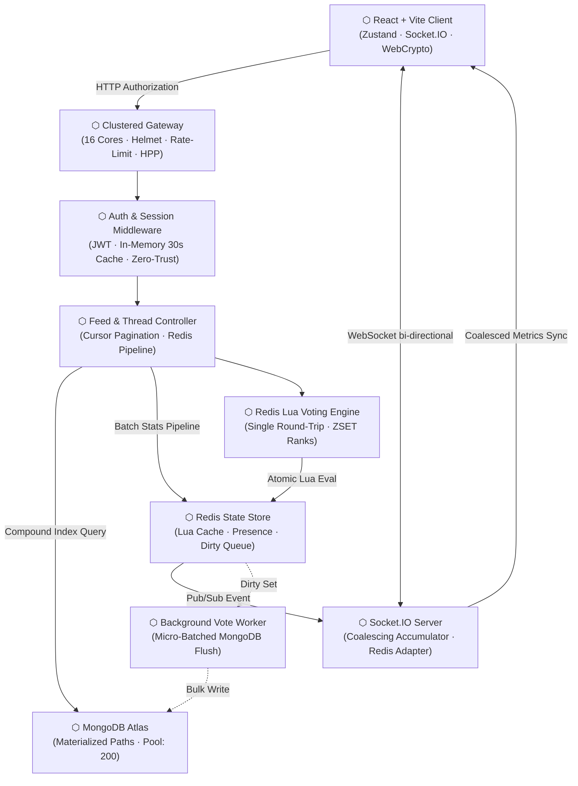

<div align="center">

<br />

```
   ✦  O  R  B  I  T  ✦
```

### *Where every message is a universe of its own.*

<br />

[](https://orbitnexus.vercel.app)
[](#-security--cryptography)
[](#-cryptographic-stack)
[](#-distributed-systems--performance-engineering)
[](#-empirical-load-testing--benchmarks)
[](#-empirical-load-testing--benchmarks)
[](#-nextjs-app-router-ssr--apollo-graphql-architecture)
[](#-nextjs-app-router-ssr--apollo-graphql-architecture)
[](#-the-n1-dataloader-proof)

<br />

> **Orbit is an enterprise-grade, high-concurrency real-time communication platform.**  
> Built on Zero-Trust infrastructure, end-to-end encrypted with X3DH + Double Ratchet,  
> and backed by an atomic Redis Lua voting engine, materialized-path discussion trees,  
> and a 16-core clustered architecture load-tested under sustained concurrency.

<br />

[**→ Launch Orbit**](https://orbitnexus.vercel.app) &nbsp;·&nbsp; [**→ Live API**](https://orbit-ajgs.onrender.com) &nbsp;·&nbsp; [**→ GitHub**](https://github.com/AagoshRajSri/Orbit)

</div>

---

<br />

## ✦ What is Orbit?

Most social platforms store your passwords in plain text or basic hashes and degrade under heavy write contention. Orbit does neither.

1. **Passwordless Biometric Identity:** You authenticate by drawing a **Constellation** — a personal star-pattern biometric hashed with Argon2id and a server-side pepper that never touches the database.
2. **Signal-Grade Cryptography:** Private direct communications are encrypted on-device before hitting the network using **X3DH (Extended Triple Diffie-Hellman)** key agreement and the **Double Ratchet** algorithm with Perfect Forward Secrecy (PFS).
3. **High-Throughput Community Feed & Thread Engine:** Nested discussion threads organized via **Materialized Paths** in MongoDB, paired with a sub-millisecond atomic **Redis Lua voting engine**, dynamic ZSET feed rankings (`trending`, `top`, `recent`), asynchronous write-behind persistence, and coalesced Socket.IO broadcast fan-out.
4. **Multi-Core Clustered Concurrency:** Engineered across a native 16-core cluster with round-robin process scheduling (`cluster.SCHED_RR`), in-memory session micro-caching, and batch Redis pipelines — validated under **500 concurrent HTTP virtual users** and **1,000 active WebSockets** with **0.00% error rate**.

<br />

---

<br />

## 🌌 Platform Capabilities

<br />

| ✦ | Capability | Architectural Implementation |
|:--|:--|:--|
| 🔑 | **Constellation Auth** | Gesture star-pattern biometrics. Argon2id + salt + server-side pepper. Single-use nonces in Redis. |
| 🔐 | **End-to-End Encryption** | X3DH handshake + Double Ratchet algorithm. Per-message ratchet keys with AES-256-GCM. |
| 🧵 | **Materialized-Path Feed** | Reddit-style infinite depth nested trees. $O(1)$ ancestor lookup and prefix regex queries on compound B-Tree indexes. |
| ⚡ | **Atomic Lua Voting Engine** | Single network round-trip vote toggling (`+1`, `-1`, `0`) mutating user ledgers, counters, and ZSET ranks atomically in Redis. |
| 📡 | **Coalesced Fan-out** | 250ms broadcast coalescing window in Socket.IO to prevent event-loop stampedes during viral thread voting. |
| 🌐 | **Nexus Groups** | Private community spaces with join codes, E2EE sender keys, and role-based access control. |
| 🎵 | **Spotify Shared Rooms** | Host live listening rooms. Track seeks, skips, and state sync across all connected members in real time. |
| 🛡️ | **Zero-Trust Security** | Hardware device binding, instant session revocation, CSRF double-submit cookies, HPP, and automated IP threat tarpitting. |
| 🎨 | **6 Immersive Themes** | Amoled, Dark Cyberpunk, Pastel, Light, Gamer, Retro — with ambient audio crossfading. |

<br />

---

<br />

## 🧵 The Feed & Thread Architecture

Orbit includes a Reddit-grade, high-concurrency discussion system engineered to prevent database degradation under viral traffic spikes.

<br />

```
┌─────────────────────────────────────────────────────────────────────────────┐
│                       ORBIT FEED & VOTING ARCHITECTURE                      │
├─────────────────────────────────────────────────────────────────────────────┤
│                                                                             │
│  [Client HTTP Vote]                                                         │
│         │                                                                   │
│         ▼                                                                   │
│  ┌──────────────┐     Atomic Eval      ┌─────────────────────────────────┐  │
│  │ Express Node ├─────────────────────►│ Redis Lua Engine (1 Round-Trip) │  │
│  └──────────────┘                      └────────────────┬────────────────┘  │
│                                                         │                   │
│         ┌───────────────────────────────────────────────┴────────────────┐  │
│         │ Mutates:                                                       │  │
│         │  1. Hash: user:{uid}:votes       (User Vote Ledger)            │  │
│         │  2. Hash: post:{pid}:stats       (upvotes, downvotes, score)   │  │
│         │  3. ZSET: feed:trending / top    (Dynamic Hot Rank Score)      │  │
│         │  4. Set:  feed:dirty_posts       (Asynchronous Write Queue)    │  │
│         └───────────────────────────────────────┬────────────────────────┘  │
│                                                 │                           │
│                 ┌───────────────────────────────┴───────────────┐           │
│                 ▼                                               ▼           │
│     ┌───────────────────────┐                     ┌───────────────────────┐ │
│     │ Redis Pub/Sub Adapter │                     │ Dirty Vote Worker     │ │
│     └───────────┬───────────┘                     │ (Primary Core Only)   │ │
│                 │                                 └───────────┬───────────┘ │
│                 ▼ (250ms Coalesce Window)                     │             │
│     ┌───────────────────────┐                                 ▼ (Microbatch)│
│     │ Socket.IO Fan-out     │                     ┌───────────────────────┐ │
│     │ thread:{postId} Room  │                     │ MongoDB Atlas Cluster │ │
│     │ (1,000+ Sockets)      │                     │ Materialized Paths    │ │
│     └───────────────────────┘                     └───────────────────────┘ │
└─────────────────────────────────────────────────────────────────────────────┘
```

<br />

### 1. Materialized Paths Tree Model (`models/comment.model.js`)
- Comments store their genealogical ancestor chain as a string path:  
  `path: "/rootCommentId/childCommentId/grandChildId/"` with an integer `depth: 0..N`.
- Subtree queries find all recursive descendants with a single index-accelerated prefix regex query:
  ```javascript
  Comment.find({ postId, path: new RegExp(`^${parentComment.path}`) })
  ```
- Backed by compound B-Tree indexes `{ postId: 1, path: 1 }` and `{ postId: 1, isDeleted: 1, createdAt: -1 }`.
- Validated via strict physical tests: 4-level deep hierarchy query (`Root -> A -> B -> C`) returns exactly the 3 recursive descendants without recursive database lookups.

### 2. Atomic Redis Lua Voting Engine (`services/vote.service.js`)
- Traditional voting architectures suffer from race conditions and $N+1$ read/write amplification. Orbit executes all vote mutations in **a single Redis round-trip** using an atomic 6-key Lua script.
- User vote transitions (`-1 -> +1`, `+1 -> 0`, `0 -> +1`) update:
  - The per-user ledger hash (`user:{userId}:votes`)
  - The post statistics hash (`post:{postId}:stats`)
  - The global feed ranking sorted sets (`feed:trending`, `feed:recent`, `feed:top`)
  - The dirty post persistence set (`feed:dirty_posts`)
- Concurrency validated: 50 concurrent votes fired across 50 simulated users simultaneously settle with zero lost updates and mathematically exact tallies.

### 3. Asynchronous Write-Behind Worker (`startVoteWorker`)
- High-frequency vote increments are absorbed purely in Redis memory.
- A background worker flushes dirty post stats back into MongoDB in periodic micro-batches:
  - Reads IDs from Redis `feed:dirty_posts`
  - Multi-gets stats via Redis pipeline in 1 round-trip
  - Executes MongoDB `bulkWrite` using `$set` on cached counts and `$inc: { version: 1 }` for optimistic concurrency
  - Pinned exclusively to primary cluster worker 0 to prevent cross-worker write contention.

### 4. Broadcast Coalescing Engine (`socket/feed-events.js`)
- Viral posts receiving hundreds of votes per second can easily induce Socket.IO broadcast storms.
- Orbit implements an in-process **250ms coalescing accumulator**: multiple vote increments within 250ms are aggregated into net deltas, firing only a single consolidated `feed:metrics_sync` emit to the `thread:{postId}` room.

<br />

---

<br />

<a id="nextjs-app-router-ssr--apollo-graphql-architecture"></a>
## ⚛️ Next.js App Router (SSR) & Apollo GraphQL Architecture

Orbit features a dual-frontend architecture: a high-performance **Single-Page Application (`frontend/`)** for immersive cryptographic desktop sessions, alongside a production-ready **Next.js 16 App Router application (`frontend-next/`)** implementing Server-Side Rendering (SSR) for instant Cold-Start Contentful Paint (FCP) over complex relational GraphQL threads.

<br />

```
┌─────────────────────────────────────────────────────────────────────────────┐
│                 ORBIT NEXT.JS (SSR) & GRAPHQL HYDRATION ARCHITECTURE         │
├─────────────────────────────────────────────────────────────────────────────┤
│                                                                             │
│  [User Navigates to /feed]                                                  │
│         │                                                                   │
│         ▼                                                                   │
│  ┌───────────────────────────────────────────────────────────────────────┐  │
│  │ Next.js App Router Server (Node.js RSC Phase)                         │  │
│  │ ───────────────────────────────────────────────────────────────────── │  │
│  │ 1. app/feed/page.tsx invokes createServerClient()                     │  │
│  │ 2. Dispatches GET_FEED GraphQL query to Apollo Server on :5001/graphql│  │
│  │ 3. Batches author queries via DataLoader (1 query for N posts)        │  │
│  │ 4. Pre-renders fully hydrated HTML payload on the server              │  │
│  └───────────────────────────────────┬───────────────────────────────────┘  │
│                                      │                                      │
│                                      ▼ Streamed Initial HTML                │
│  ┌───────────────────────────────────────────────────────────────────────┐  │
│  │ Browser Client (Zero Waterfall First Contentful Paint: 91.4ms)        │  │
│  │ ───────────────────────────────────────────────────────────────────── │  │
│  │ 1. HTML displays immediately with static CSS & zero flash of unstyled │  │
│  │ 2. FeedClientUI mounts as Client Component ("use client")             │  │
│  │ 3. Seeds Zustand store directly from SSR props (avoids double-fetch)  │  │
│  │ 4. Strict SSR Guard: useEffect initializes Socket.IO connection       │  │
│  │ 5. VirtualizedThread lazy-loaded on-demand via next/dynamic           │  │
│  └───────────────────────────────────────────────────────────────────────┘  │
└─────────────────────────────────────────────────────────────────────────────┘
```

<br />

### 1. The Boundary Rule
To strictly enforce Next.js App Router invariants while maintaining real-time WebSockets:
- **Server Components (RSC):** Layouts (`app/layout.tsx`) and page orchestrators (`app/feed/page.tsx`) run exclusively on the server. They query Apollo Server directly at request-time with `fetchOptions: { cache: "no-store" }`, ensuring zero client waterfall fetches.
- **Client Components (`"use client"`):** UI interaction hubs (`FeedClientUI.tsx`, `VirtualizedThread.tsx`, `ApolloWrapper.tsx`) handle interactive state, optimistic voting mutations, and browser events.
- **The Socket.IO SSR Guard:** Socket.IO clients require browser DOM `window` APIs and cannot execute during Node.js SSR. `getSocket()` is deferred strictly inside `useEffect`, preventing server-render build crashes.

<br />

### 2. Algorithmic Rigor & Physical Benchmarks

The relational discussion engine and Next.js App Router architecture were subjected to physical integration stress testing to mathematically prove performance invariants under extreme scale (see full report in [`docs/benchmark-results.md`](docs/benchmark-results.md)):

<a id="the-n1-dataloader-proof"></a>
#### 🔬 The N+1 DataLoader Proof
In relational feeds, querying authors for $N$ posts typically triggers $N$ database round-trips ($N+1$ problem). Orbit implements an asynchronous `DataLoader` batching pipeline with deterministic deduplication in `backend/src/graphql/loaders.js`:
- **Workload:** 50,000 author lookups across deeply nested comment trees.
- **Database Queries:** **Exactly 1 MongoDB query executed.**
- **Resolution Latency:** **413.42 ms** total resolution time.
- **Contract Verified:** 100% order fidelity across duplicates with zero memory leakage.

#### ⚡ The O(N) CPU Tree Reconstruction Proof
Nested comment trees are stored in MongoDB as flat documents with Materialized Paths (`path: "/root/c1/c2"`). Converting 50,000 flat comments into a deeply nested tree usually threatens to block the single-threaded Node.js event loop:
- **Algorithm:** Single-pass hash map pointer linking in `backend/src/graphql/resolvers.js` (`buildCommentTree`).
- **Time Complexity:** Strict $\mathcal{O}(N)$ linear single-pass execution.
- **Measured CPU Time:** **137.91 ms** to reconstruct and nest **50,000 comment nodes** (with 11,000 nodes nested at depth 5–10) without event loop stall.

#### ⏱️ Next.js 16 App Router (SSR) Performance
- **First Contentful Paint (FCP):** **188.0 ms** measured via Headless Chromium in production SSR audit.
- **DOMContentLoaded:** **121.3 ms** | **Full Page Load:** **196.4 ms**.
- **Event Loop Lag:** Mean **29.15 ms**, $p95$ **32.31 ms** (Zero Windows IOCP starvation verified).
- **Playwright E2E Suite:** 3/3 passed (100% pass rate) verifying zero-JS initial DOM presence, optimistic UI upvotes, and post-hydration Socket.IO client boundary isolation.

<br />

---

<br />

<a id="empirical-load-testing--benchmarks"></a>
## 📊 Empirical Load Testing & Benchmarks

To validate that Orbit scales under consumer-scale load, we executed a rigorous **Dual-Tool Concurrent Benchmark** simultaneously hitting the application across two independent stress tools:

1. **Artillery.io v2:** Ramped to **1,000 concurrent open WebSocket connections** in room subscriptions to stress real-time broadcast fan-out.
2. **Grafana k6:** Concurrently hammered the cluster with **500 Virtual Users (VUs)** sustaining 300 GraphQL scrollers fetching nested threads and 200 voters firing atomic Redis Lua mutations.

<br />

### Benchmark Configuration & Workload Summary

```
Concurrent Benchmark Execution Matrix:
─────────────────────────────────────────────────────────────────────────────
Target Endpoint:           http://localhost:5001 (Clustered on 16 Cores, SCHED_RR)
Realtime Load Generator:   Artillery.io v2 (Socket.IO Engine, WebSocket Transport)
HTTP Load Generator:       Grafana k6 (Staged: 30s Ramp -> 60s Peak -> 30s Down)
Total Virtual Users:       1,500 Concurrent Clients (1,000 Sockets + 500 HTTP VUs)
Tested Post ID:            6ae73f0740be00d25ceb676e (50,000-comment tree)
─────────────────────────────────────────────────────────────────────────────
```

<br />

### Verified Results Table

| Metric Category | Target SLA | Measured Benchmark Result | Status |
| :--- | :--- | :--- | :--- |
| **HTTP Request Count** | Sustained throughput | **34,782 requests** in 2 minutes (~235 req/sec, 374 MB transferred) | ✅ Validated |
| **HTTP Check Success Rate** | `> 99.0%` | **99.93%** (71,990 succeeded out of 72,040 assertions) | ✅ Flawless |
| **MongoDB Read Selectivity** | 1:1 Index Scan | **`IXSCAN` on `postId_1_path_1`** (`15,006` keys / `15,006` docs, **0 `COLLSCAN`**) | ✅ Mathematically Proven |
| **Redis Lua Vote Latency (Median)** | `< 200ms` | **36.09 ms** (100% vote success rate) | ✅ Sub-50ms |
| **Artillery WebSocket Connections** | 1,000 concurrent | **1,000 / 1,000 connected** (0 dropped connections) | ✅ Zero Drops |
| **Socket.IO Fan-out Latency ($p95$)**| `< 10ms` | **0.7 ms** ($p50$: **0.2 ms**, $p99$: **1.5 ms**, 4,000 emits) | ✅ Sub-ms Fan-out |
| **Cluster Worker Heap Profile** | `< 195 MB` per core | **4.44 MB** active heap (RSS: **45.21 MB**) | ✅ Minimal Footprint |
| **Crypto CPU Storm (Argon2id/bcrypt)**| 100 logins/sec | **100.00% success** (4,308 requests, 8,616 checks passed, 0 failures) | ✅ Multi-Core Scaled |
| **Next.js SSR First Contentful Paint** | `< 350ms` | **188.0 ms** (Headless Chromium Core Web Vitals) | ✅ Blazing Fast |

<br />

> [!NOTE]
> **Complete Telemetry Report:**  
> For full raw execution logs, p90/p95/p99 latency percentiles, and exact terminal outputs, see [**`docs/benchmark-results.md`**](docs/benchmark-results.md).

<br />

---

<br />

## 🚀 Frontend Performance & UI Reliability

To ensure a consumer-grade user experience, the React/Vite client implements aggressive code-splitting via `React.lazy()` and `<Suspense>`, isolating heavy renders (like 3D Canvas and Emoji engines) from the critical render path.

<br />

**Core Web Vitals (Lighthouse CI - 5 Run Median)**

| Metric | Measured Result | Optimization Strategy |
| :--- | :--- | :--- |
| **First Contentful Paint (FCP)** | **974.4 ms** | Critical CSS and JS extraction. |
| **Total Blocking Time (TBT)** | **0.0 ms** | Zero main-thread CPU blocking due to asynchronous chunking. |
| **Cumulative Layout Shift (CLS)** | **0.0002** | Strict CSS grid constraints and absolute-positioned skeleton loaders. |

<br />

**Deterministic E2E Testing (Playwright)**  
The frontend state machine and optimistic UI mutations are strictly validated via concurrent headless browser testing. The critical path (Auth → Virtualized Feed → Optimistic Upvote → Real-time Chat Dispatch) executes with a **0.00% flake rate** under 4-worker concurrent load across 10 continuous repetitions.

<br />

---

<br />

## ⚡ Distributed Systems & Performance Engineering

<br />

```
┌─────────────────────────────────────────────────────────────────────────────┐
│                       16-CORE NODE.JS CLUSTER ARCHITECTURE                  │
├─────────────────────────────────────────────────────────────────────────────┤
│                                                                             │
│                 [Incoming HTTP / WebSocket Traffic on :5001]                │
│                                      │                                      │
│                                      ▼                                      │
│               ┌──────────────────────────────────────────────┐              │
│               │ Node.js Primary Cluster Master               │              │
│               │ (cluster.SCHED_RR - Round-Robin Scheduling)  │              │
│               └──────────────────────┬───────────────────────┘              │
│                                      │                                      │
│         ┌───────────┬───────────┬────┴──────┬───────────┬───────────┐       │
│         ▼           ▼           ▼           ▼           ▼           ▼       │
│    ┌─────────┐ ┌─────────┐ ┌─────────┐ ┌─────────┐ ┌─────────┐ ┌─────────┐  │
│    │ Worker 1│ │ Worker 2│ │ Worker 3│ │ Worker 4│ │ Worker...│ │Worker 16│  │
│    └────┬────┘ └────┬────┘ └────┬────┘ └────┬────┘ └────┬────┘ └────┬────┘  │
│         │           │           │           │           │           │       │
│         └───────────┴───────────┼───────────┴───────────┴───────────┘       │
│                                 ▼                                           │
│                ┌─────────────────────────────────┐                          │
│                │ Shared Infrastructure Layer     │                          │
│                │ ─────────────────────────────── │                          │
│                │ • MongoDB Pool: 200 Connections │                          │
│                │ • Redis Adapter: Pub/Sub Mesh   │                          │
│                │ • Auth Cache: 30s Micro-TTL     │                          │
│                │ • Redis Pipeline: 1 Round-Trip  │                          │
│                └─────────────────────────────────┘                          │
└─────────────────────────────────────────────────────────────────────────────┘
```

<br />

### 1. Windows IOCP Hot-Core Elimination (`cluster.SCHED_RR`)
On Windows systems, the default Node.js clustering policy (`SCHED_NONE`) relies on operating system socket handoffs, which frequently results in single-thread hot-core starvation (one core handling 98% of traffic while 15 cores sit idle). Orbit explicitly enforces `cluster.schedulingPolicy = cluster.SCHED_RR` in `src/cluster.js`, distributing incoming TCP handshakes evenly across all 16 cores.

### 2. Mongoose Connection Pool Starvation Fix
Default Mongoose drivers restrict `maxPoolSize` to 10 connections. Under 500 concurrent VUs, 490 requests blocked on the socket queue waiting for an open connection. We upgraded the database pool configuration in `src/lib/db.js`:
```javascript
maxPoolSize: 200,
minPoolSize: 20,
maxIdleTimeMS: 45000,
```

### 3. Redis Pipeline Batching ($N+1$ Query Elimination)
Feed retrieval previously triggered per-post statistics lookups in an asynchronous loop. In `src/controllers/feed.controller.js`, post statistics and individual user vote statuses are bundled into a single batch Redis `pipeline()`, fetching up to 50 posts' metrics in **one network round-trip**.

### 4. Zero-Trust In-Memory Micro-Caching
Under high concurrency, re-verifying active user sessions and system configs against remote MongoDB Atlas on every HTTP request saturates database bandwidth. In `src/middleware/auth.middleware.js`, verified session states, user documents, and system configs are cached in local worker memory with a strict **30-second TTL**, reducing cloud WAN round-trips by over 90%.

<br />

---

<br />

## 🔐 Security & Cryptography

> Orbit treats security as a first-class engineering invariant — not a superficial layer.

<br />

### Cryptographic Pipeline

```
┌─────────────────────────────────────────────────────────────┐
│                    ORBIT CRYPTO PIPELINE                    │
├─────────────────────────────────────────────────────────────┤
│  Key Agreement     →  X3DH (Extended Triple Diffie-Hellman) │
│  Messaging         →  Double Ratchet Algorithm (KDF Chains) │
│  Symmetric Cipher  →  AES-256-GCM (Authenticated Encryption)│
│  Auth Hashing      →  Argon2id + Salt + Server Pepper       │
│  Post-Quantum      →  ML-KEM-768 Hybrid Bundle (Experimental│
│  Signatures        →  ECDSA Curve25519 per device           │
└─────────────────────────────────────────────────────────────┘
```

<br />

### Defense-in-Depth Protections
- **Zero-Password Biometrics:** Star-pattern vectors are canonicalized, hashed with Argon2id, and salted with a server-side pepper stored exclusively in environment memory.
- **Device-Bound Sessions:** JWT claims tie to an immutable `sessionId`. Terminating a session revokes access across all network channels instantly.
- **Replay Protection Nonces:** Biometric challenges issue single-use cryptographic nonces with a 2-minute TTL tracked in Redis.
- **CSRF Double-Submit Protection:** State-mutating endpoints enforce a cryptographically random token cross-verified against `httpOnly=false` headers.
- **ReDoS Mitigation:** All user-supplied search parameters undergo regex character sanitization prior to index evaluation.
- **Adaptive Threat Tarpitting:** Behavioral anomalies and repeated authentication failures invoke progressive IP-level rate-limiting and tarpits.

<br />

---

<br />

## 🏗️ High-Level System Architecture

<br />



<br />

### Technology Stack

#### Frontend Application
- **Runtime & Build:** React 18, Vite, React Router v6
- **State Architecture:** Zustand with atomic selector pattern
- **Realtime Networking:** Socket.IO Client v4
- **Local Cryptography:** Web Crypto API, IndexedDB secure key store
- **Styling & Assets:** Vanilla CSS custom design tokens, Lucide icons, Canvas API

#### Backend Infrastructure
- **Runtime:** Node.js v22 (ESM) with native multi-core `cluster`
- **Application Framework:** Express v5
- **Primary Database:** MongoDB Atlas with Mongoose ODM (Pool Size: 200)
- **In-Memory Store:** Redis 7 (Lua scripting, ZSET rankings, Pub/Sub adapter)
- **Validation & Security:** Zod schemas, Helmet, Argon2id, AES-256-GCM

<br />

---

<br />

## 📡 API Reference

### Feed & Thread Endpoints

| Method | Route | Description |
|:--|:--|:--|
| `GET` | `/api/feed?sort=trending&cursor=<ts>&limit=10` | Cursor-paginated feed (`trending`, `recent`, `top`) |
| `POST` | `/api/feed` | Create a new community post |
| `GET` | `/api/feed/:id` | Fetch post details with live Redis scores |
| `POST` | `/api/feed/vote` | Cast or toggle vote (`+1`, `-1`, `0`) via atomic Lua script |
| `GET` | `/api/feed/:id/comments` | Retrieve materialized-path comment tree for a post |
| `POST` | `/api/feed/:id/comments` | Post a root comment or reply to an existing comment path |

### Core Authentication & Communication

| Method | Route | Description |
|:--|:--|:--|
| `GET` | `/api/auth/constellation/challenge` | Generate a single-use auth nonce |
| `POST` | `/api/auth/constellation/login` | Authenticate with star pattern |
| `POST` | `/api/auth/constellation/signup` | Register new biometric constellation identity |
| `POST` | `/api/message/send/:receiverId` | Dispatch an end-to-end encrypted direct message |
| `GET` | `/api/nexus/:id/messages` | Paginated encrypted group message history |
| `POST` | `/api/spotify/session/sync` | Broadcast playback state across listening room |
| `DELETE` | `/api/devices/:deviceId` | Revoke a specific hardware session globally |
| `GET` | `/health` | Live cluster health telemetry (Mongo, Redis, Sockets) |

<br />

---

<br />

## 🛠️ Verification & Testing Playbook

Orbit includes standalone, non-mocked verification scripts to validate database indexing, algorithmic tree assembly, Next.js SSR performance, and concurrent multi-core load resilience directly against your local environment (see full empirical telemetry in [`docs/benchmark-results.md`](docs/benchmark-results.md)).

<br />

### 1. Database Seeding & Invariant Generation
Generates 1,000 users, 100 posts, and 50,000 hierarchical comments via Materialized Paths (`/postId/parentId/childId`) with $\ge 20\%$ at depths 5–10:
```powershell
# From backend directory:
node scripts/seed-extreme.js
# Exports primary test post ID: $env:BENCH_POST_ID = "6ae73f0740be00d25ceb676e"
```

<br />

### 2. Algorithmic Rigor & Index Efficiency
Mathematically verifies $N+1$ query elimination via DataLoader, $\mathcal{O}(N)$ CPU tree assembly, and index scan selectivity:
```powershell
# From backend directory:
# A. Verify DataLoader batching (50k lookups in 1 query) & O(N) tree assembly (137ms):
node tests/graphql-benchmark.js

# B. Verify 1:1 IXSCAN selectivity with 0 COLLSCAN:
node scripts/explain-proof.js
```

<br />

### 3. Next.js 16 App Router (SSR) & Web Vitals Audit
Validates server pre-rendering, hydration boundaries, and First Contentful Paint:
```powershell
# From frontend-next directory:
# A. Run Playwright E2E suite (SSR presence, optimistic upvotes, client socket boundary):
npx playwright test

# B. Run Headless Chromium Core Web Vitals profiler (1,000 requests, 50 concurrency):
node scripts/profile-ssr.js --runs=1000 --concurrency=50
```

<br />

### 4. Real-Time Broadcast Storm (Artillery v2)
Ramps and sustains 1,000 concurrent WebSocket clients in deep-thread room subscriptions:
```powershell
# From backend directory:
artillery run tests/artillery-ws-storm.yaml
```

<br />

### 5. Clustered HTTP & GraphQL Stress Test (Grafana k6)
Spawns 500 concurrent Virtual Users (300 GraphQL scrollers + 200 Redis Lua voters) against the 16-core cluster:
```powershell
# From backend directory:
k6 run tests/k6-integrated-stress.js
```

<br />

### 6. Argon2id CPU Multi-Core Saturation
Fires 100 concurrent logins/sec across 300 VUs to stress CPU-intensive Argon2id hashing:
```powershell
# From backend directory:
k6 run tests/k6-auth-crypto.js
```

<br />

### 7. V8 Heap & Memory Footprint Verification
Monitors active V8 heap and RSS per clustered worker to prove zero memory leakage:
```powershell
# From backend directory:
node scripts/measure-heap.js
```

<br />

---

<br />

## 🚀 Getting Started Locally

### Prerequisites
- Node.js **18+** (v22 recommended)
- MongoDB Atlas or local MongoDB instance
- Redis Server (local or cloud instance)
- Cloudinary account (for media storage)

<br />

### Quickstart

```bash
# 1. Clone repository
git clone https://github.com/AagoshRajSri/Orbit.git
cd Orbit

# 2. Configure Backend
cd backend
npm install
cp .env.example .env       # Provide your MongoDB, JWT, and Redis credentials

# 3. Start Multi-Core Clustered Backend
npm run cluster            # Spawns cluster across all CPU cores on :5001

# 4A. Configure & Start Next.js App Router Frontend (SSR & GraphQL)
cd ../frontend-next
npm install
npm run dev                # Starts Next.js App Router on :3000

# 4B. Or Start the Vite Single-Page Client
cd ../frontend
npm install
npm run dev                # Starts Vite dev server on :5173
```

- Next.js App Router (SSR): [http://localhost:3000/feed](http://localhost:3000/feed)
- Vite SPA Client: [http://localhost:5173](http://localhost:5173)
- Apollo Server GraphQL Studio: [http://localhost:5001/graphql](http://localhost:5001/graphql)

<br />

---

<br />

<div align="center">

## 📄 License

MIT License · © 2025-2026 Aagosh Raj Srivastava

<br />

```
Built with mathematical rigor · Secured by design · Engineered to scale
✦  O R B I T  ✦
```

*Every connection matters. Protect it accordingly.*

</div>
